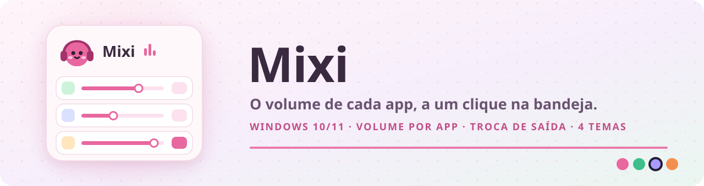
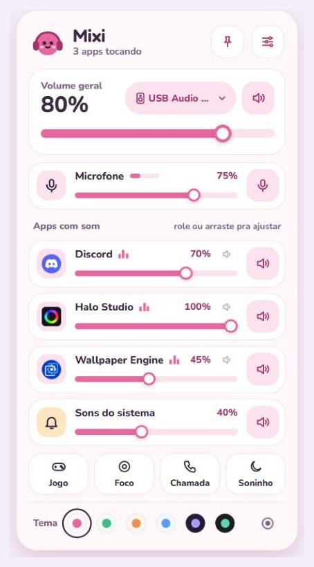
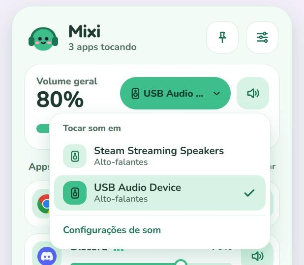
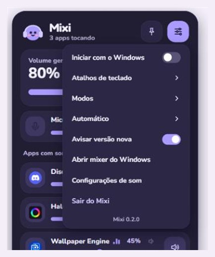
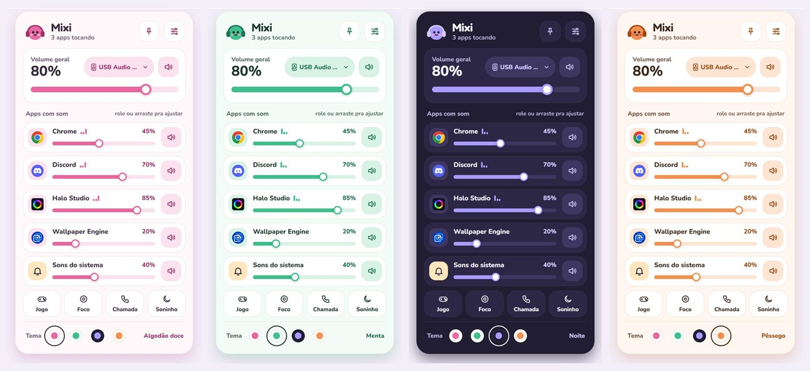
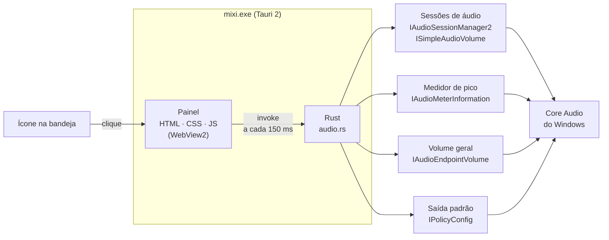

<p align="center">
  
</p>

<p align="center">
  
  
  
  
  <a href="LICENSE"></a>
</p>

<p align="center">
  O Windows deixa mudar o volume de cada app, mas escondido em três cliques nas Configurações.<br>
  O <b>Mixi</b> mora na <b>bandeja</b>: um clique no mascote e aparece o volume de <b>cada app que está tocando</b>,
  com o ícone dele, o mudo, a <b>troca de saída</b> (fone, caixa, TV) e <b>modos prontos</b> pra jogo, foco e chamada.
</p>

<p align="center">
  
</p>

---

## Recursos

<table>
  <tr>
    <td width="33%" valign="top">
      <br>
      <b>Volume de cada app</b><br>
      Todo app que abriu o som aparece com o ícone e o nome dele. Arraste, ou use a <b>roda do mouse</b> em cima da linha (2% por clique). O Chrome com várias abas vira uma linha só.
    </td>
    <td width="33%" valign="top">
      <br>
      <b>Quem está tocando</b><br>
      Barrinhas animadas ao lado do nome, lidas do medidor de pico do próprio Windows. Dá pra achar na hora aquela aba que começou a tocar sozinha.
    </td>
    <td width="33%" valign="top">
      <br>
      <b>Trocar a saída</b><br>
      Fone, caixa de som ou TV no HDMI, num clique. Muda a saída de mídia e a de chamadas juntas, e cada uma tem o ícone do tipo dela.
    </td>
  </tr>
  <tr>
    <td valign="top">
      <br>
      <b>Modos rápidos</b><br>
      <b>Jogo</b>, <b>Foco</b>, <b>Chamada</b> e <b>Soninho</b> ajustam tudo de uma vez, por tipo de app: música, chat, navegador, sistema e o resto (jogos).
    </td>
    <td valign="top">
      <br>
      <b>4 temas</b><br>
      Algodão doce, Menta, Noite e Pêssego. O mascote muda de cor junto, e o tema escolhido fica salvo.
    </td>
    <td valign="top">
      <br>
      <b>Mora na bandeja</b><br>
      Abre no canto, acima da barra de tarefas, no monitor onde está o mouse. Some quando você clica fora, ou fica fixado com o alfinete.
    </td>
  </tr>
  <tr>
    <td valign="top">
      <br>
      <b>Leve de propósito</b><br>
      Executável de ~3,5 MB e ~30 MB de RAM. Usa o WebView2 que já vem no Windows, sem Electron. Fechado, só dá uma olhadinha no áudio a cada 1,5 s.
    </td>
    <td valign="top">
      <br>
      <b>Linha de comando</b><br>
      <code>mixi --set spotify 30</code>, <code>mixi --output fone</code>… Bom pra atalhos do teclado, macros e scripts.
    </td>
    <td valign="top">
      <br>
      <b>Liga com o Windows</b><br>
      Uma chave no menu e ele já sobe escondido na bandeja. Só um Mixi roda por vez.
    </td>
  </tr>
  <tr>
    <td valign="top">
      <br>
      <b>Microfone</b><br>
      Volume, mudo e o nível ao vivo de quanto ele está captando. O mudo vale pro microfone padrão e pro de chamadas, então pega no Discord também.
    </td>
    <td valign="top">
      <br>
      <b>Atalhos do seu jeito</b><br>
      Você grava a combinação e escolhe o que ela faz: mudo do microfone, o <b>app que está na tela</b>, um app específico, uma saída, um modo… Um aviso aparece embaixo sem roubar o foco do jogo.
    </td>
    <td valign="top">
      <br>
      <b>Mascote que reage</b><br>
      Na bandeja ele dorme quando nada toca, ganha um selo quando o microfone está mudo e fica com os fones cinza quando o som está mudo. Dá pra saber se o Discord te ouve só de olhar.
    </td>
  </tr>
</table>

## Telas

<table>
  <tr>
    <td width="50%"><br><sub><b>Saída de áudio</b>: as saídas ativas, com a atual marcada. Um clique e o Windows passa a tocar por ali.</sub></td>
    <td width="50%"><br><sub><b>Configurações</b>: iniciar com o Windows, atalhos pro mixer e pro som do Windows, e sair.</sub></td>
  </tr>
  <tr>
    <td colspan="2" align="center"><br><sub><b>Temas</b>: Algodão doce, Menta, Noite e Pêssego. Troca na hora pelas bolinhas do rodapé.</sub></td>
  </tr>
  <tr>
    <td colspan="2" align="center"><br><sub><b>Na bandeja</b>: acordado, dormindo (nada tocando há 20 s), microfone mudo e som mudo (fones cinza). Os dois mudos aparecem juntos.</sub></td>
  </tr>
</table>

## Como funciona



- O **painel** é uma página simples (`ui/`) e não sabe nada de áudio: ele pede o estado ao Rust e manda os ajustes.
- O **Rust** fala direto com o Core Audio do Windows (WASAPI), o mesmo que o mixer das Configurações usa. Cada sessão de áudio é ligada ao `.exe` dono dela, e é dele que saem o nome e o ícone.
- A **troca de saída** usa a interface interna `IPolicyConfig`. O Windows não tem API pública pra isso; EarTrumpet e SoundSwitch usam a mesma, do Windows 7 ao 11.
- Com o painel **fechado**, a interface fica parada (sem consultas nem animações). Só uma thread do Rust confere a cada 1,5 s se algo está tocando e se o microfone está mudo, pra trocar a cara do mascote.
- Os **atalhos** são registrados no Windows (`RegisterHotKey`): o Mixi só fica sabendo dessas combinações, nunca do resto do que você digita. O aviso é uma janelinha que não pega o foco e deixa o clique passar.

## Instalação

 **Compilar** (Rust estável com MSVC, Build Tools do Visual Studio 2022, WebView2)

```powershell
git clone https://github.com/Everteson/mixi
cd mixi\src-tauri
cargo build --release
.\target\release\mixi.exe
```

Na primeira vez o `cargo` baixa e compila as dependências (uns 3 minutos). O executável fica em `src-tauri\target\release\mixi.exe`, e dá pra copiar ele pra onde quiser: a interface vai embutida.

> [!TIP]
> Se o mascote ficar escondido na setinha `^` da bandeja, arraste ele pra barra de tarefas.

 **Iniciar com o Windows:** botão direito no mascote → **Iniciar com o Windows**, ou pelo menu de configurações do painel. Ele grava em `HKCU\...\Run` com `--hidden`, então sobe só na bandeja.

## Usando

| Onde | O que faz |
|---|---|
| **Clique** no mascote da bandeja | abre ou fecha o painel |
| **Botão direito** no mascote | abrir, mixer do Windows, iniciar com o Windows, sair |
| **Arrastar** um slider | muda o volume (e tira do mudo) |
| **Roda do mouse** numa linha | ±2% |
| Botão do **alto-falante** | mudo do app (ou de tudo, no volume geral) |
| Botão da **saída** (ao lado do volume geral) | escolhe onde o som toca |
| **Jogo · Foco · Chamada · Soninho** | ajusta tudo de uma vez |
| **Alfinete** | o painel não some ao clicar fora |
| **Esc** | fecha o menu aberto, ou o painel |

 **Atalhos de teclado**, de qualquer lugar. Os de fábrica:

| Atalho | O que faz |
|---|---|
| `Ctrl` `Alt` `M` | liga ou muta o microfone |
| `Ctrl` `Alt` `PgUp` / `PgDn` | sobe ou desce 5% o app que está na tela (sem som, mexe no volume geral) |
| `Ctrl` `Alt` `O` | passa pra próxima saída de áudio |
| `Ctrl` `Alt` `V` | abre ou fecha o painel |

Pra mudar ou criar os seus: **Configurações → Atalhos de teclado**. Clique nas teclas de um atalho e aperte a combinação nova (com `Ctrl`, `Alt` ou `Win`, ou uma tecla `F` sozinha). Depois é só escolher o que ele faz:

- mudo do microfone, de tudo, do app na tela ou de **um app específico** (ex.: só o Discord);
- aumentar ou diminuir o app na tela, um app específico ou o volume geral;
- próxima saída, ou **uma saída específica** (ex.: sempre o fone);
- **ativar um modo** (Jogo, Foco, Chamada, Soninho);
- abrir o Mixi.

O editor avisa quando a combinação está **repetida** ou quando **outro programa já usa**. Tem também a chave pra desligar todos e o **Restaurar padrão**.

> [!TIP]
> Em teclados ABNT2, o `AltGr` funciona como `Ctrl`+`Alt`. Evite `Ctrl`+`Alt` com teclas que você usa com `AltGr` (como `Q`, `W`, `E` e os números), senão o caractere (`/`, `?`, `°`, `¹`…) para de sair.

 Na linha de comando:

```powershell
mixi --set spotify 30        # volume de um app (nome do .exe), 0 a 100
mixi --set geral 60          # volume geral
mixi --outputs               # lista as saídas de áudio
mixi --output fone           # troca a saída (parte do nome)
mixi --dump                  # o que o Mixi enxerga, em JSON
mixi --hidden                # abre só na bandeja
mixi --pinned                # abre com o painel fixado
```

## Personalizar

- **Modos:** `MODES` e `CATEGORIES` no `ui/app.js`. Cada modo é um volume por tipo de app; as categorias são listas de nomes de `.exe`.
- **Temas:** as variáveis no topo do `ui/style.css` (`[data-theme="..."]`) e a lista `THEMES` no `ui/app.js` (as bolinhas).
- **Ações dos atalhos:** `run()` no `src-tauri/src/hotkeys.rs` e a lista `HK_ACTIONS` no `ui/app.js` (os ids precisam bater).
- **Nomes dos apps:** `known_name()` no `src-tauri/src/audio.rs`. Os que não estão lá usam a descrição do próprio `.exe`.
- **Mascote e ícones:** `tools/make_icons.py` desenha o mascote e gera `icon.ico` e `tray.png` sem dependências.
- **Só o visual:** abra `ui/index.html` no navegador. Sem o Tauri, ele usa apps de mentira e dá pra mexer em tudo sem compilar.

## Privacidade e segurança


- O Mixi não tem servidor, conta nem telemetria. O único acesso à internet é o das fontes (Nunito e Fredoka) no Google Fonts; sem internet, ele usa a Segoe UI.
- Roda sem administrador. Só escreve no registro se você ligar o **Iniciar com o Windows** (em `HKCU`, só pro seu usuário). As preferências (inclusive os seus atalhos) ficam em `%APPDATA%\com.mixi.volume\settings.json`.
- Ele lê o caminho do `.exe` de cada app com som pra mostrar o nome e o ícone, e nada além disso.
- A troca de saída usa uma interface interna do Windows (`IPolicyConfig`); se a Microsoft mudar essa interface, essa parte pode parar de funcionar.

## Testado em

Windows 11 Pro (build 26200), com dois monitores, saída USB e Steam Streaming Speakers. Deve funcionar no Windows 10 (são as mesmas APIs), mas ainda não testei.

## Créditos


- **[Tauri](https://tauri.app)** (MIT / Apache 2.0): a janela, a bandeja e a ponte entre o painel e o Rust.
- **[windows-rs](https://github.com/microsoft/windows-rs)** (MIT / Apache 2.0): acesso ao Core Audio, ao registro e aos ícones.
- **[EarTrumpet](https://github.com/File-New-Project/EarTrumpet)**: a inspiração, e a prova de que o `IPolicyConfig` funciona bem pra trocar a saída.
- **[Nunito](https://fonts.google.com/specimen/Nunito)** e **[Fredoka](https://fonts.google.com/specimen/Fredoka)** (SIL OFL 1.1): as fontes do painel.
- Código, mascote e ícones feitos com o **[Claude Code](https://claude.com/claude-code)**.

Projeto pessoal, sem ligação com a Microsoft. Os nomes e ícones dos apps que aparecem nas telas pertencem aos seus donos.

## Licença

[MIT](LICENSE). Use, modifique e compartilhe à vontade.
